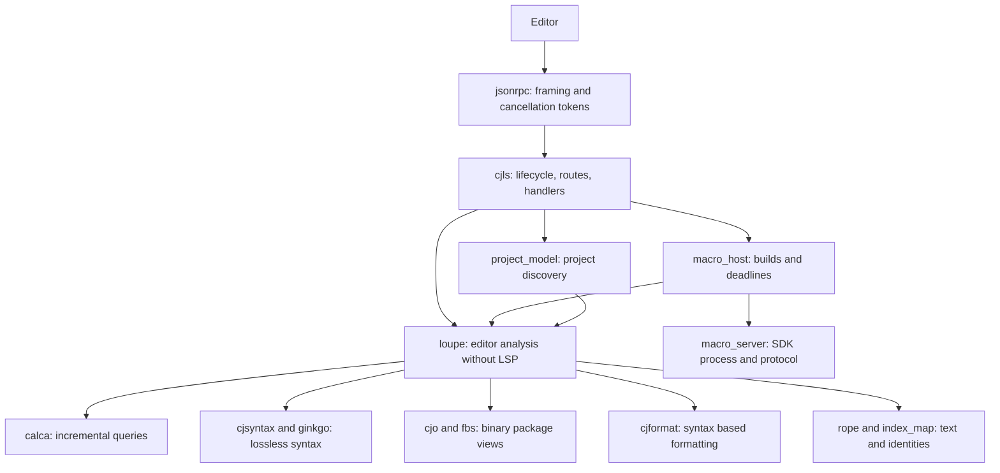
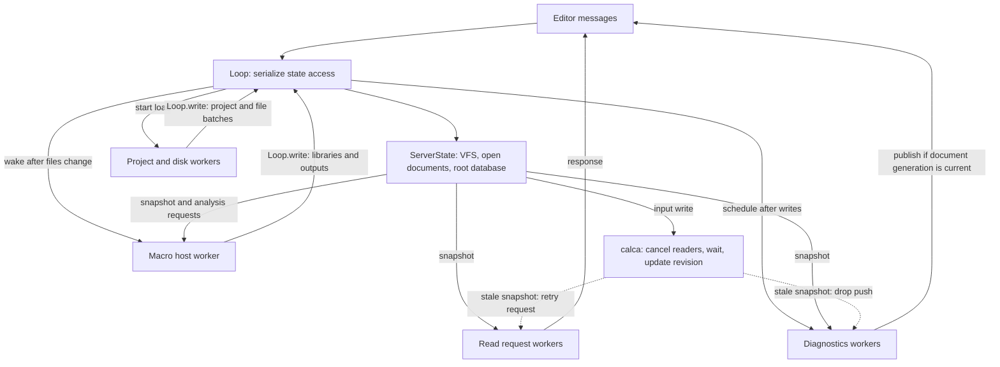

# Architecture

cjls separates the editor protocol from reusable language analysis. This overview
connects the flows and source entry points; [design rules](README.md#design) hold
the constraints, [ADRs](adr/README.md) their reasons, and
[Development](development.md) setup and verification.

## Modules and boundaries

`cjls` owns the connection lifecycle, routing, open documents and protocol
translation. `loupe` owns analysis, with incremental state supplied by `calca`.
The compiler enforces the module boundary: `loupe` has no dependency on `cjls`
and cannot import its LSP types. Modules are reusable libraries with independent
dependencies and output types; server-only code is a package of `cjls` (D3).
Packages are compilation units, so adding a module does not buy build parallelism.
Nothing depends on the executable module.

An experimental second frontend, [`cjmcp`](../modules/cjmcp/README.md), exposes
a `runPython` MCP tool with embedded CPython and native analysis objects over
`project_model` and `loupe`. It is a separate executable; its sequential workspace
lifecycle and current Linux-only runtime limitations are documented with the
module. An explicit analysis revision retains the database that owns HIR/type
identities, so workspace reloads cannot silently reinterpret a retained view. It does not depend on `cjls` or change the LSP request loop.

Exact dependencies are in each module's `cjpm.toml`. `platform`, on std alone,
supplies common declarations with OS-specific implementations
([C17](design/03-conventions.md#c17-platform-source-sets), D101).

The [layer map](design/00-layers.md) names L0–L7. Across the handler/analysis
boundary, URIs, LSP positions and negotiated encodings become `FileId`, UTF-8 byte
offsets and analysis-owned results. Position conversion uses the text of the same
snapshot as the answer ([D5](adr/0005-loupe-knows-no-lsp.md)).

## A read request and an edit

For `textDocument/documentSymbol`, the read loop checks lifecycle and routing and
takes a snapshot linked to the request's cancellation token. A worker decodes the
parameters, translates the URI, calls analysis and converts the result using the
snapshot's rope. The [request slice](design/01-request-slice.md) gives each step.

`textDocument/didChange` instead runs exclusively on the read loop, in arrival
order. It applies edits to the open buffer in the negotiated encoding, folds VFS
changes into analysis inputs and opens a new calca revision. This path changes
inputs and runs no queries. Open buffers belong to the editor; disk loads cannot
overwrite them. Background work returns changes through the loop's write boundary.

`ServerState` owns the VFS, open documents, encoding and root `AnalysisDatabase`.
`ServerSnapshot` holds a snapshot of that database and the request's view of
server data. Neither server type is itself a database. Distinct handler context
types give a read handler a snapshot instead of mutable `ServerState` (D8, D9).
They do not prohibit external effects such as file writes or requests to the
client. The contract for such effects and automatic retries is tracked separately
in [#462](https://github.com/ide4cj/cjls/issues/462).

A write cancels queries in flight and waits before updating inputs. A stale read
request retries on a fresh snapshot; client cancellation ends it. Diagnostics
pushes drop stale work instead. See [cancellation](design/01-request-slice.md#cancellation-d8)
and the freshness checks below.

## State ownership and background work

Workers feed new inputs back into analysis; writes invalidate snapshots and
schedule more work. These arrows show execution and data flow.

`Loop` serializes mutable server access under one lock: both exclusive handlers
and background `Loop.write` calls use it, and snapshots are taken under it.
Background commits therefore happen between handled messages; they need not run
on the read-loop thread. `ServerState` owns the mutable server data, and calca owns
revision and dependency validity. Workers use snapshots or copied task inputs and
return changes through this write boundary rather than mutating the VFS or root
database directly ([S14](design/01-request-slice.md#s14-background-writes-use-the-loop)).

| Work | Who starts it | Who accepts the result and checks freshness |
|---|---|---|
| Read request | `Server.onRequest`, with a snapshot and request token | Server answers; stale snapshots retry, client cancellation ends the request |
| Project/disk load | Workspace handlers through `Loop.start` | Load commits use `Loop.write`; `ServerState` checks the load id and preserves open buffers |
| Macro work | Workspace setup starts the host; `Loop.afterWrite` wakes it when files change | Host rounds read snapshots and commit outputs through `Loop.write`, matched by stable call keys; an edit ends a round and later rounds ask again |
| Diagnostics push | `Loop.afterWrite`, for clients that cannot pull | `DiagnosticsPush` computes from a snapshot and checks the document's publish generation before sending |

Serializing a write does not by itself make its result current. Start in
[`Loop`](../modules/cjls/src/server/loop.cj),
[`workspace loading`](../modules/cjls/src/handlers/workspace.cj),
[`macro scheduling`](../modules/cjls/src/macro_host/host.cj) and
[`diagnostics push`](../modules/cjls/src/server/push.cj) when changing these paths.

## Analysis and incremental state

Inside `loupe`, dependencies point down: API → HIR → syntax → database → VFS.
Features share lower-level queries. Position-dependent API functions stay plain;
tracked queries use entity keys ([A1–A3](design/02-analysis.md#rules)).

The VFS folds text changes under stable file identities. Project loading lowers
one normalized model into project, module and package inputs. File membership and
durability come from that model ([A5, A17–A18](design/02-analysis.md#rules)).

Binary packages are inputs of their `.cjo` bytes outside the VFS (D38); source
files attached to a binary have detached contexts for browsing bodies and imports,
using the binary's canonical declarations without adding import candidates or
workspace symbols (D65, D147). Queries lower source and binary declarations to the same
item model. Binary views borrow their input bytes: tracked results keep a stable
binary item identity and reopen the declaration instead of retaining `cjo.Decl`.

Resolution proceeds through file items, package scopes, signatures, bodies and
inference. Item summaries omit bodies and ranges so body edits can leave package
scope unchanged; stable identities and equal query results limit recomputation.
Diagnostics travel as query results, collected and located by the API. The
[analysis rules](design/02-analysis.md) define these contracts.

## Syntax and generated code

`ginkgo` supplies tree infrastructure; `cjsyntax` the lexer, grammar, recovery and
typed views. Lossless parsing keeps incomplete buffers usable. `loupe.syntax`
memoizes parsing with a bounded cache; other tracked results must not retain its
trees ([A13](design/02-analysis.md#a13-do-not-retain-syntax-trees)).

`cjformat` formats syntax without analysis; the server reaches it through `loupe`,
and `cjls fmt` can use it on text. Generated syntax kinds and AST views come from
`syntax_codegen` (D10), LSP types and adapters from `lsp_codegen`, and binary views
and protocol writers from `fbs_codegen` (D37, D87). Change generator inputs and
verify the consuming package; see [generator procedures](development.md).

## Macros and protocol isolation

Analysis identifies calls and writes requests as plain values. Macro outputs are
a separate input field of the source file; changing an output invalidates its
readers without changing source text (D98). The written and expanded scope stages
keep macro-name lookup independent of what expansion adds, avoiding a query cycle
([A31](design/02-analysis.md#a31-written-and-expanded-scopes)).

`macro_host` builds workspace macro packages, orders work, applies deadlines and
returns results to inputs. `macro_server` owns the SDK's `LSPMacroServer` process,
its FlatBuffers protocol and conversion from syntax tokens to compiler tokens.
Server-specific scheduling, settings and open documents stay in `cjls.macro_host`.
Thus `loupe` depends on neither SDK macro protocol structures nor LSP. std macros
can run through the same host, with analysis fallback expansions where specified
by D123. An expansion is read as a file in its call site's scope; mapped spans say
which text came from source and which the macro wrote. Current navigation limits,
body expansion limits and stable call keys are explicit in
[A35](design/02-analysis.md#a35-reading-macro-expansions).

LSP stdout is the wire. Logs use the supplied logger, and absent optional fields
remain distinct from JSON `null` (`@Serde[skipNone]`). The router and generated
specifications are the maintained protocol inventory; [LSP extensions](lsp-extensions.md)
document the additional client-facing contracts.

## Source entry points

| Change or question | Start here |
|---|---|
| Supported routes and one read handler | [router](../modules/cjls/src/handlers/router.cj), [document symbols](../modules/cjls/src/handlers/document_symbol.cj) |
| Server scheduling, snapshots, edits | [server](../modules/cjls/src/server/server.cj), [state](../modules/cjls/src/server/state.cj), [document sync](../modules/cjls/src/handlers/document_sync.cj) |
| Position and result conversion | [from protocol](../modules/cjls/src/handlers/from_proto.cj), [to protocol](../modules/cjls/src/handlers/to_proto.cj) |
| Incremental writes and cancellation | [database](../modules/loupe/src/db/db.cj), [calca runtime](../modules/calca/src/runtime.cj) |
| Analysis features and their tests | [loupe source](../modules/loupe/src/), [structure example](../modules/loupe/src/structure.cj) |
| Stable items, scopes, inference | [item tree](../modules/loupe/src/hir/item_tree.cj), [definition map](../modules/loupe/src/hir/def_map.cj), [inference](../modules/loupe/src/hir/infer.cj) |
| Syntax ownership and recovery | [green tree](../modules/ginkgo/src/green.cj), [Cangjie parsing](../modules/cjsyntax/src/parse.cj), [parse query](../modules/loupe/src/syntax/syntax.cj) |
| Macro input and output boundaries | [analysis requests](../modules/loupe/src/hir/server_macro.cj), [input composition](../modules/loupe/src/hir/macro_input.cj), [output values](../modules/loupe/src/db/macro_output.cj), [host](../modules/macro_host/src/), [SDK protocol](../modules/macro_server/src/) |
| Analysis fixtures and SDK prerequisites | [analysis testing](design/02-analysis.md#analysis-tests), [fixture helpers](../modules/loupe/src/fixture/) |

Find current symbols and behavior in the source and neighboring tests.
